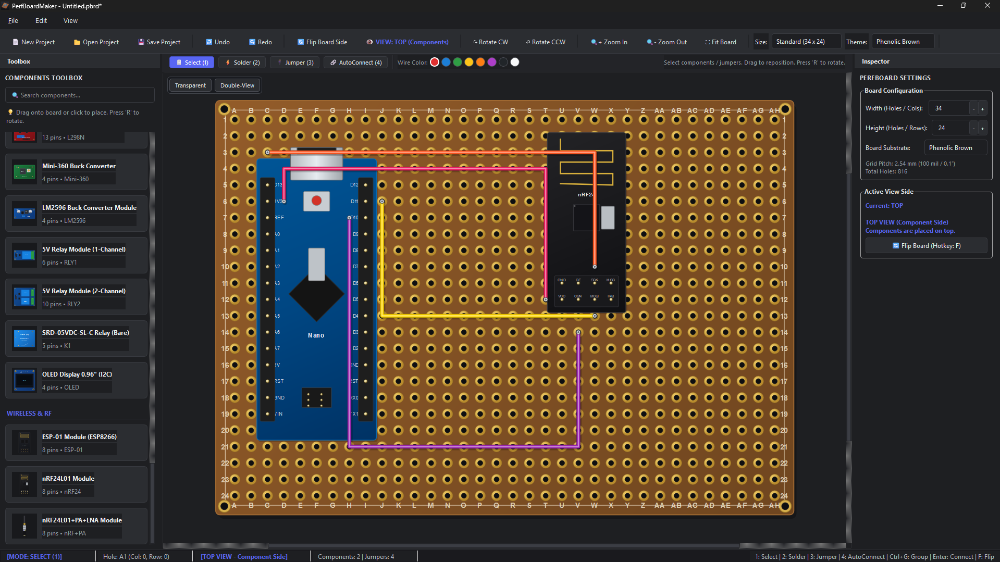
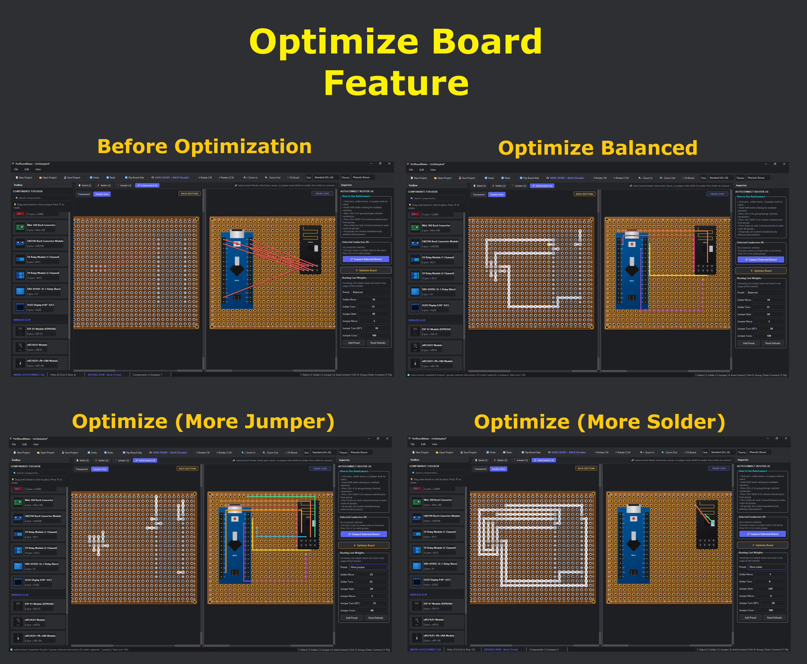
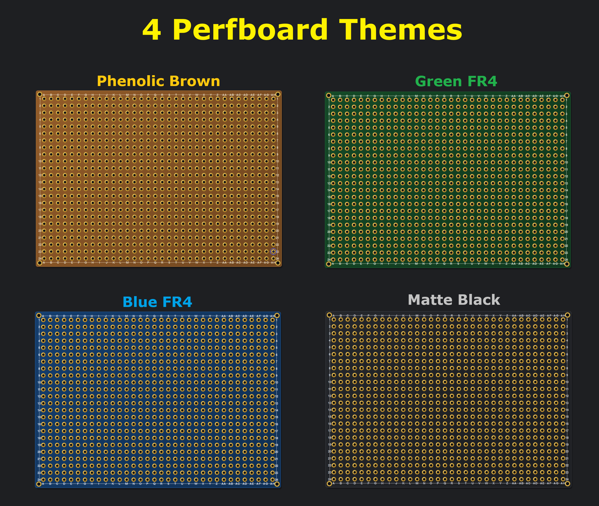

# Very Important Bug Fix
it seems like every version before v0.22 has a bug on the updater logic, so anyone using 0.21 or below will not be able to get the new updates just by clicking the glowing update button, they will have to re-download the project from github. I am sorry for the inconvenience.

# PerfBoardMaker ⚡

A desktop 2D orthogonal electronic CAD application for designing, routing, and prototyping perfboard circuits. Built with Python & PyQt6, featuring an accelerated native C++ multi-net AutoConnect router.



---

## Key Features

### 1. Viewport Toolbar & Editing Modes
- **Select Mode (`1`)**:
  - Select, move, and rotate (`R` / `Shift+R`) components or drag jumper endpoints and bend handles.
  - **Solder Net Highlighting & Selectable Solder Paths**: Hovering over a solder pad, trace, or jumper on the Back View (or Front View with **Transparent PCB** enabled) highlights the entire conductive net in gold. Clicking a solder path selects it and displays every connected component pin (both direct and bridged via jumpers) in a resizeable **Connected Pins** table in the Inspector.
- **Solder Mode (`2`)**:
  - Draw realistic tinned solder bridges on the back side of the perfboard. Traces stay isolated unless connected through a shared hole.
  - **Erase (`LCtrl` + Click/Drag)**: Remove soldered holes or trace segments; disconnected branches automatically split into separate traces.
  - **Axis Lock (`Shift`)**: Constrain traces strictly horizontally or vertically.
  - Shows dashed ghost solder guides when viewing the Front side in Solder mode.
- **Jumper Mode (`3`)**:
  - Draw clean, straight insulated jumper wires on either the Front (`top`) or Back (`bottom`) side.
  - **Bend Points (`Shift + Click`)**: Insert draggable bend points along any jumper wire body to route neatly around components without shorting intermediate holes.
  - Quick-pick wire colors in both the Viewport Toolbar and Inspector.
- **AutoConnect Router Mode (`4`)**:
  - Select pins, solder traces, or jumper ends (`Shift + Click` for multi-select), group nets with **`Ctrl+G`** (`Ctrl+Shift+G` to ungroup), and press **`Enter`** (or click **Connect**) to route all nets simultaneously without shorts or intersections.
  - **Native C++ Acceleration**: Powered by `app/native/router_core.dll` with seamless Python fallback.
  - **Optimize Board**: Automatically traces electrical continuity across all placed component pins, groups connected nets, clears existing traces/jumpers, and re-routes the entire board cleanly.
  - **Cost Weight Presets & Live Tuning**: Adjust routing weights (*Solder Move*, *Solder Turn*, *Jumper Start*, *Jumper Move*, *Jumper Turn*, *Jumper Cross*) in real time, switch between **`Balanced`**, **`More jumper`**, and **`More solder`**, or save custom presets.



### 2. Multi-View & Inspection Tools
- **Top & Bottom 2D Orthogonal Views (`F`)**:
  - **Top (Component Side)** shows component bodies, silkscreen labels, and leads.
  - **Bottom (Solder Side)** mirrors the board horizontally ($x' = \text{width} - x$) like flipping a real PCB, showing metallic solder joints, pin labels, and translucent top-component outlines.
- **Transparent PCB Toggle**: Makes the perfboard substrate semi-transparent so back-side solder traces, opposite-side silhouettes, and conductive net highlights are visible and selectable directly from the Front View.
- **Transparent Components Toggle**: Makes component artwork semi-transparent independently of the PCB, solder traces, and jumper wires in both views.
- **Double-View Toggle**: Splits the viewport side-by-side (**Front** & **Back**) with live synchronized edits, mirrored wheel zoom, a mirrored `"+"` partner cursor matching the exact corresponding board coordinate, and a right-click middle splitter menu (`← / →`) to swap Left and Right sides.
- **Split Inspector Panel**: Always displays active tool/mode settings in the top pane while dynamically revealing selected Component, Jumper, or Solder Path properties in the bottom pane (automatically hidden when nothing is selected).


### 3. Procedural Perfboard & Workspace
- **Edge-Drag Dynamic Resizing**: Drag any edge or corner of the perfboard in the canvas to add or remove rows/columns without shifting existing components, solder traces, or jumpers out of place.
- **Board Themes & Presets**: Choose *Green FR4*, *Phenolic Brown (Bakelite)*, *Blue FR4*, or *Matte Black FR4* (your last used theme is remembered across launches). Board presets include Standard (`34×24`), Small (`24×18`), Compact (`20×14`), Large (`48×32`), Eurocard (`60×40`), or Custom dimensions.
- **Project Workflow**: `.pbrd` JSON project save/load, automatic launch fit-to-board, **200-step Undo/Redo**, periodic **Autosave** snapshots, and high-resolution **PNG Export (`Ctrl+E`)**.



---

## Component Library (47 Built-in Parts)

- **Microcontrollers (8)**: Arduino Nano, ESP8266 Wemos D1 Mini, ESP8266 NodeMCU v2 (Narrow) & v3 (Wide), ESP32 DevKit v1 (30-pin), ESP32 DevKitC (38-pin), ESP32-C3 SuperMini, ESP32-C6 SuperMini.
- **Passives & Switches (15)**: Axial 1/4W Resistor, Ceramic Capacitor (`2.54mm`), Electrolytic Capacitors (`5mm`, `8mm`, `10mm`), Axial Diode, LEDs (`3mm`, `5mm`), Crystal Oscillator (`HC-49S`), Piezo Buzzer (`12mm`), Trimmer Potentiometer, Rotary Potentiometer (`16mm`), SPDT Slide Switch, Push Button (`6×6mm` with configurable `3×3` or `4×3` hole footprint), Tactile Button (`12×12mm`).
- **Connectors & Headers (7)**: Pin Header `1xN` & `2xN` (configurable pin count / male or female), Screw Terminals (`2.54mm` & `5.08mm`), DC Barrel Jack (`5.5×2.1mm`), JST-XH Connectors (`2-pin` & `3-pin`).
- **Semiconductors & ICs (6)**: DIP-8, DIP-14, DIP-16, DIP-28 IC Packages, TO-220 Package IC (renameable), TO-92 Package IC (renameable).
- **Power, Motor Drivers & Displays (8)**: MX1508 Motor Driver, L298N Motor Driver Module, Mini-360 Buck Converter, LM2596 Buck Converter Module, 5V Relay Modules (1-Channel & 2-Channel), SRD-05VDC-SL-C Bare Relay, OLED Display `0.96"` (I2C).
- **Wireless & RF (3)**: ESP-01 Module (ESP8266), nRF24L01 Module, nRF24L01+PA+LNA Module.

---

## Keyboard & Mouse Shortcuts

| Shortcut | Action |
| :--- | :--- |
| **`1` / `2` / `3` / `4`** | Switch between Select / Solder / Jumper / AutoConnect modes |
| **`F`** | Flip board view (Top / Bottom) |
| **`R` / `Shift+R`** | Rotate selected or ghost component 90° CW / CCW |
| **`LCtrl` + Click/Drag** *(Solder)* | Erase solder holes or bridges |
| **`Shift` + Click** *(Jumper body)* | Insert a bend point |
| **`Shift` while drawing** | Lock trace or jumper to horizontal / vertical |
| **`Ctrl+G` / `Ctrl+Shift+G`** *(AutoConnect)* | Group / ungroup selected conductors |
| **`Enter`** *(AutoConnect)* | Run AutoConnect routing |
| **`Delete` / `Backspace`** | Delete selected component, jumper, or solder path |
| **`Esc`** | Clear current selection or cancel active tool action |
| **`Space + Drag` / `Middle` / `Right Drag`** | Pan canvas |
| **`Mouse Wheel`** | Zoom in / out |
| **`Ctrl+0`** | Fit board in view |
| **`Ctrl+Z` / `Ctrl+Y` (`Ctrl+Shift+Z`)** | Undo / Redo (up to 200 steps) |
| **`Ctrl+N` / `Ctrl+O` / `Ctrl+S` / `Ctrl+Shift+S`** | New / Open / Save / Save As `.pbrd` project |
| **`Ctrl+E`** | Export board image to PNG |

---

## Running the App

Requires **Python 3.10+** and **PyQt6**:

```bash
pip install PyQt6
python run.py
```

Or on Windows, double-click `start.bat`.


## LICENSE

This project is licensed under the Creative Commons Attribution-NonCommercial 4.0 International License — see the LICENSE file for details. You are free to use and customize this app, but commercial use or selling it is not permitted.
